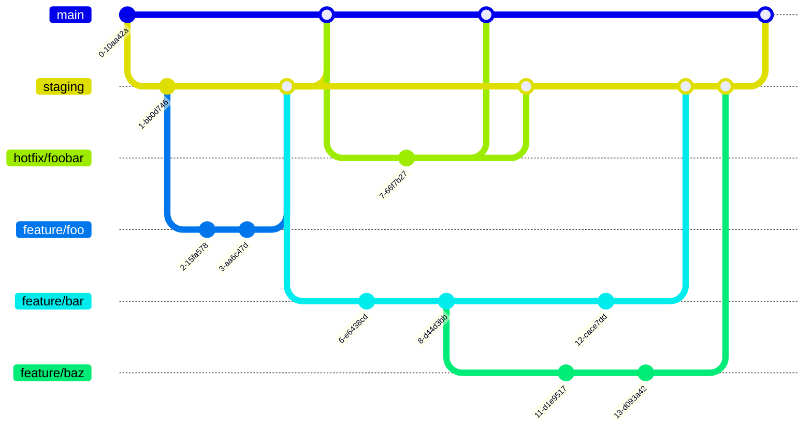

# リポジトリ運用ガイドライン

> **このリポジトリでの適用優先順位**: `AGENTS.md` のアクセス制約とユーザーの明示指示を最優先します。通常の開発は `staging` から開始し、PRのbaseを `staging` に指定します。以下に記載する別リポジトリ作成の一般論は、他リポジトリへのアクセスや新規作成の許可を意味しません。


> **ステータス**: Draft / **対象**: 開発メンバー全員

>

>

> 本ガイドラインは「迷わない・揃う・あとから追える」ことを目的とした運用ルールです。

> 例外が必要な場合は、PRまたはチームで相談のうえ本ガイドラインを更新してください。

>

## 目次

はじめに（目的）

2. ブランチ運用ルール

3. コミットメッセージ規約

4. プルリクエスト（PR）運用規約

5. リリース・タグ運用規約

6. 付録：チェックリスト

---

## 1. はじめに（目的）

### 1.1 目的

変更の「意図・範囲・影響」を、ブランチ名・コミット・PRから読み取れる状態にする

レビューの負担を下げ、手戻りを減らす

リリースのバージョン番号と変更履歴（リリースノート）を、ルールに沿って一貫して残す

### 1.2 参考規格

Conventional Commits 1.0.0（日本語）

Semantic Versioning 2.0.0（日本語）

GitFlow（Atlassian）

ブランチ保護ルールを管理する（GitHub Docs）

---

## 2. ブランチ運用ルール

### 2.1 リポジトリの作成

案件ごとにリポジトリを作成する。

ただし、kintoneと別サーバーを併用する場合など、**デプロイ先・構成が異なるものはそれぞれ別リポジトリ**にする。

### 2.2 リポジトリ作成時に必ず行う設定

| # | 設定 | 補足 |

| --- | --- | --- |

| 1 | **`main` をデフォルトブランチにする** | |

| 2 | `staging` ブランチを作成する | 通常作業の切り元・PRの向き先 |

| 3 | `Settings > General > Pull Requests > Automatically delete head branches` を **OFF（チェックを外す）** にする | マージ後の `staging` の自動削除を防ぐ |

| 4 | `.github/pull_request_template.md` を配置する | PR本文を統一するためのテンプレート |

> ⚠️ **注意**: ブランチ保護を設定できない運用を前提に、マージ後のブランチ自動削除は **OFF** にします。

>

### 2.3 ブランチ戦略

基本は **GitFlow**をベースにした運用です。

`main`：本番に相当するブランチ（リリース済みの状態、**デフォルトブランチ**）

`staging`：ステージング環境に相当するブランチ（通常作業の切り元・PRの向き先）

`feature/*`：通常の作業ブランチ

`hotfix/*`：本番の緊急対応ブランチ

`main` と `staging` へ直接コミット・pushせず、作業ブランチからPRで変更を取り込みます。`main` と `staging` は、マージ後も削除しません。

案件によって `develop` と `staging` の両方が存在する場合などは、そのリポジトリの `AGENTS.md` / `CLAUDE.md` / `README.md` に役割と運用を明記します。



#### kintoneの場合

kintone開発でも、通常は `main` / `staging` / `feature/*` を使い、本番の緊急対応では `hotfix/*` を使います。

| ブランチ | 対応する環境・用途 |

| --- | --- |

| `main` | 本番環境 |

| `staging` | kintoneのステージング環境 |

| `feature/*` | 開発環境での通常作業 |

| `hotfix/*` | 本番の緊急不具合修正 |

### 2.4 ブランチ命名規則

| 種別 | 命名 | 切り元 | マージ先 |

| --- | --- | --- | --- |

| 通常（機能追加・修正など） | `feature/<作業概要を表す名称>` | `staging` | `staging` |

| 緊急対応 | `hotfix/<作業概要を表す名称>` | `main` | **`main` と `staging` の両方** |

名称は**英小文字・数字・ハイフン（`-`）**で、作業内容が分かる短い表現にする

例：`feature/add-login-form`、`feature/123-fix-cart-total`、`hotfix/payment-timeout`

Issueがある場合は番号を含めると追跡しやすい（任意）

> 💡 **提案（要チーム確認）**: 作業内容を明確にするため、`feature/` の代わりに `fix/` `refactor/` `docs/` `chore/` を使えるようにすることも検討できます。

採用が決まるまでは、通常作業は `feature/`、緊急対応は `hotfix/` を使います。

>

採用する場合の対応例は次のとおりです。

| プレフィックス | 用途 | 対応するコミットtype |

| --- | --- | --- |

| `feature/` | 新機能・機能拡張 | `feat` |

| `fix/` | 不具合修正 | `fix` |

| `refactor/` | 挙動を変えない内部改善 | `refactor` |

| `docs/` | ドキュメントのみ | `docs` |

| `chore/` | ビルド・設定・依存関係など | `chore` / `build` / `ci` |

### 2.5 ブランチの切り方

#### 通常

作業ブランチは、最新の **`staging`** から切ります。

デフォルトブランチの `main` と取り違えないようにしてください。

```bash
git switch staging
git pull origin staging
git switch -c feature/add-login-form
```

#### 進行中のブランチを拡張・修正する場合

既に進行中のブランチがあり、その内容を拡張・修正する必要がある場合は、そのブランチから作業ブランチを切ります。

切り元がまだマージされていない場合、PRは**切り元のブランチに対して**出す。

理由：`staging` 宛てにすると、切り元の未マージの変更まで差分に含まれ、今回の変更箇所が分かりにくくなるため。

切り元のブランチが `staging` にマージされた後は、PRの向き先を `staging` に変更し、差分を再確認する。

#### 緊急対応

`hotfix/<作業概要を表す名称>` を **`main` から切る**。

2. 修正後、レビューを経て **`main` と `staging` の両方**にマージする。

3. 緊急であっても、本番に影響しない修正であれば、通常作業と同じく **`staging` から切る**。

---

## 3. コミットメッセージ規約

Conventional Commits 1.0.0に準拠します。

### 3.1 基本フォーマット

```
<type>(<scope>): <description>
[body（任意）]
[footer（任意）]
```

| 要素 | 必須 | ルール |

| --- | --- | --- |

| `type` | 必須 | 変更の種類（3.2参照） |

| `scope` | 任意 | 影響範囲（例：`auth` `api` `ui` `deps` `kintone`）。使わない場合は括弧ごと省略 |

| `description` | 必須 | 変更内容の要約。簡潔に、文末にピリオドは付けない |

| `body` | 任意 | 「なぜ」変更したかの補足。`description` の後に1行空けて記載 |

| `footer` | 任意 | Issue参照（`Closes #123`）、破壊的変更（`BREAKING CHANGE:`）など |

### 3.2 typeの一覧

| type | 用途 | 例 |

| --- | --- | --- |

| `feat` | 新機能の追加 | `feat(auth): add Google login` |

| `fix` | バグ修正 | `fix(cart): correct total when coupon applied` |

| `docs` | ドキュメントのみの変更 | `docs: add setup steps to README` |

| `style` | 挙動に影響しない整形（空白・フォーマッタ適用など） | `style: apply prettier` |

| `refactor` | 機能追加でもバグ修正でもないコード改善 | `refactor(user): extract validation logic` |

| `perf` | パフォーマンス改善 | `perf(api): cache product list query` |

| `test` | テストの追加・修正 | `test(auth): add token expiry cases` |

| `build` | ビルドシステム・外部依存の変更 | `build: upgrade webpack to v5` |

| `ci` | CI/CD設定の変更 | `ci: run tests on pull_request` |

| `chore` | 上記に当てはまらない雑務 | `chore: update .gitignore` |

| `revert` | コミットの取り消し | `revert: revert "feat(auth): add Google login"` |

### 3.3 破壊的変更（BREAKING CHANGE）

後方互換性を壊す変更は、typeに `!` を付けるか、footerに `BREAKING CHANGE:` を書いて明示します。SemVerのMAJORを上げる対象です。

```
feat(api)!: remove deprecated /v1/users endpoint
BREAKING CHANGE: /v1/users has been removed. Use /v2/users instead.
```

### 3.4 具体例

**Good**

```
feat(cart): add coupon code input
Users can now apply a coupon code at checkout.
Invalid codes display an inline error message.
Closes #123
```

```
fix(login): prevent double submit on slow network
```

```
refactor(payment): split PaymentService into smaller modules
```

```
chore(deps): bump axios from 1.6.0 to 1.7.2
```

日本語で統一しているリポジトリでは、次のように記載できます。

```
fix(login): 保存ボタン連打による二重送信を防止
```

**Bad**

| NG例 | 理由 | 改善例 |

| --- | --- | --- |

| `fix bug` | 形式違反・何を直したか不明 | `fix(cart): correct total when coupon applied` |

| `update` | 情報がない | `chore(deps): update eslint to v9` |

| `feat: add login and fix header and update deps` | 複数の目的が混在 | コミットを分割する |

| `WIP` | 変更内容が分からない | 作業中は手元に留め、整理してからpushする |

### 3.5 コミットの運用ルール

1コミット = 1つの論理的な変更にする（複数目的を混ぜない）。

2. 機密情報（APIキー・パスワード・個人情報・顧客情報）は絶対にコミットしない。

3. 説明文の言語（日本語 / 英語）は、リポジトリ内で統一する。`type` と `scope` は英語にする。

---

## 4. プルリクエスト（PR）運用規約

### 4.1 PRの作成ルール

**PRタイトルはConventional Commits形式**にする（例：`feat(cart): add coupon code input`）。

2. **Reviewers** にレビュアーを、**Assignees** にPRを出した人（自分）を設定する。

3. PRの向き先（base）は、通常は **`staging`**。デフォルトブランチの `main` と取り違えないこと。進行中ブランチから切った場合は、そのブランチ（2.5参照）。本番の緊急対応は、2.5の緊急対応の手順に従う。

4. 1PR = 1目的。差分が大きくなる場合は分割する。

5. UIの変更がある場合は、スクリーンショットや動画を添付する。

6. レビュー依頼前に、自分で差分を一度確認する（セルフレビュー）。

### 4.2 PRテンプレート

`<リポジトリルート>/.github/pull_request_template.md` に配置します。

以下の各項目を埋めてください。該当しない項目は「なし」と記載します。

ただし、「特に確認してほしいこと」がない場合は、そのセクションを削除して構いません。

```markdown
## PRの概要
<!-- 何を変更し、どのような動作・状態になるかを簡潔に説明 -->
## 関連Issue
<!-- 例: Closes #123 / Refs #456（なければ「なし」） -->
-
## 変更内容
<!-- 主な変更点を箇条書きで -->
-
## 確認手順
<!-- レビュアーに実施してほしい手順、確認先のURLなど -->
-
### 資料
<!-- スクリーンショット、動画、議事録などの関連資料 -->
-
## 動作確認観点
<!-- テストの操作・条件 -->
<!-- 期待する結果 -->
<!-- テストの操作・条件 -->
<!-- 期待する結果 -->
## 特に確認してほしいこと
<!-- なければセクションを削除 -->
```

### 4.3 レビュー指摘（FB）への対応

指摘された各コメントを修正したら、**各コメントに「修正した」ことを返信**する。

可能であれば、修正したコミットのURLも貼る。

2. 全件対応後、**PRに新規コメントで「修正完了」を伝える**。

各コメントへの返信だけでは、すべての修正が完了したか分からないため。

修正中に指摘以外で追加対応したことがあれば、その完了コメントにも書く。

必要に応じて、PRの説明欄にも追記する。

---

## 5. リリース・タグ運用規約

### 5.1 マージ後の手順

| 項目 | 内容 |

| --- | --- |

| kintoneの場合 | 案件ごとに用意したステージング環境・本番環境への反映手順に従う |

| `main` へのマージ時 | **タグの付与**と**リリースノートの作成**を行う（5.2〜5.4） |

`staging → main` のマージ後も、`staging` は削除しません。

### 5.2 バージョン命名規則（SemVer）

タグはSemantic Versioningに準拠し、**`vMAJOR.MINOR.PATCH`**（例：`v1.0.0`）とします。

| 区分 | 上げるタイミング | 対応するコミット | 例 |

| --- | --- | --- | --- |

| MAJOR | 後方互換性のない変更 | `!` 付き / `BREAKING CHANGE:` | `v1.4.2` → `v2.0.0` |

| MINOR | 後方互換性のある機能追加 | `feat` | `v1.4.2` → `v1.5.0` |

| PATCH | 後方互換性のあるバグ修正・性能改善 | `fix` / `perf` | `v1.4.2` → `v1.4.3` |

MINORを上げたらPATCHは `0` に、MAJORを上げたらMINOR・PATCHは `0` に戻す。

前回リリース以降の変更のうち、**最も影響の大きいもの**で上げる区分を決める。

例：`feat` と `fix` が含まれる場合、破壊的変更がなければMINORを上げる。

`docs` / `test` / `chore` / `ci` / `refactor` のみの場合は、リリースするかどうかは任意。リリースする場合はPATCHを上げる。

タグの先頭に `v` を付ける（例：`v1.2.3`）。

初回リリース直後など公開仕様が安定していない期間は `v0.y.z` を使ってもよい。

**公開済みのタグは変更・削除しない**。誤りがあれば新しいバージョンを作成する。

### 5.3 タグ付けとリリースの手順

#### Step 1: リリース対象の確認

`main` を最新化し、前回タグ以降の変更を確認します。

```bash
git switch main
git pull origin main
git log $(git describe --tags --abbrev=0)..HEAD --oneline
```

初回リリースでタグがまだない場合は、`git log --oneline` などでリリース対象を確認します。

コミットのtypeと変更内容を見て、5.2の基準で次のバージョンを決めます。

#### Step 2: タグの作成とpush

タグは、リリース対象となる **`main` のコミットに注釈付きタグ**として付けます。

以下は `v1.5.0` をリリースする場合の例です。

```bash
git tag -a v1.5.0 -m "Release v1.5.0"
git push origin v1.5.0
```

> `git push --tags` は意図しないタグまで送ってしまうため使わず、**タグ名を指定してpush**してください。

>

#### Step 3: GitHub Releaseの作成（リリースノート）

**GitHubの画面から**

リポジトリの `Releases` → `Draft a new release` を開く。

2. `Choose a tag` で、作成したタグ（例：`v1.5.0`）を選択する。

3. タイトルにバージョン（例：`v1.5.0`）を入力する。

4. **`Generate release notes` をクリック**し、含めるPRの一覧を自動生成する。

5. 内容を確認し、注意事項・移行手順・kintoneの反映内容などを必要に応じて手動で追記する。

6. `Publish release` で公開する。

**GitHub CLIから**

```bash
gh release create v1.5.0 --title "v1.5.0" --generate-notes
```

公開前に生成内容を確認・編集したい場合は、下書きとして作成します。

```bash
gh release create v1.5.0 --title "v1.5.0" --generate-notes --draft
```

#### Step 4: 公開後の確認

[ ] Releaseページにタグとリリースノートが表示されている

[ ] 主要なPRがリリースノートに漏れなく含まれている

[ ] 破壊的変更がある場合、冒頭に移行手順が記載されている

[ ] kintoneの場合、案件ごとのステージング・本番への反映手順に沿って反映した

### 5.4 hotfixのリリース

`hotfix/<名称>` を `main` から切って修正し、PRを出す。

2. レビュー後、**`main` と `staging` の両方**にマージする。

3. 後方互換性のある不具合修正では、`main` へのマージ後に **PATCHを上げたタグ**を付け、リリースノートを作成する。

例：`v1.5.0` → `v1.5.1`

4. 案件ごとの手順に従って本番へ反映する。

### 5.5（任意）リリースノートの分類設定

`.github/release.yml` を置くと、PRに付けたラベルでリリースノートをカテゴリ分けできます。

```yaml
changelog:
  categories:
    - title: "Breaking Changes"
      labels: [breaking-change]
    - title: "New Features"
      labels: [feature, enhancement]
    - title: "Bug Fixes"
      labels: [bug, fix]
    - title: "Other Changes"
      labels: ["*"]
```

---

## 付録：チェックリスト

### リポジトリ作成時（管理者）

[ ] 案件ごと（kintoneと別サーバーなど構成が違う場合は別）にリポジトリを作成した

[ ] `main` をデフォルトブランチにした

[ ] `staging` ブランチを作成した

[ ] `Automatically delete head branches`（マージ後のブランチ自動削除）を **OFF** にした

[ ] `.github/pull_request_template.md` を配置した

### PR作成時（開発者）

[ ] ブランチ名が `feature/<概要>` または `hotfix/<概要>` になっている

[ ] PRタイトルがConventional Commits形式になっている

[ ] Reviewers / Assigneesを設定した

[ ] PRテンプレートの各項目を埋めた

[ ] baseブランチが正しい（通常は `staging`。進行中ブランチの拡張・緊急対応は2.5に従う）

[ ] 自分で差分を確認した

### `main` マージ時

[ ] 次バージョンをSemVerで決めた

[ ] `main` のリリース対象コミットにタグ（`vX.Y.Z`）を付けてpushした

[ ] `Generate release notes` でリリースノートを作成し、必要な項目を追記した

[ ] マージ後も `main` と `staging` が維持されていることを確認した
